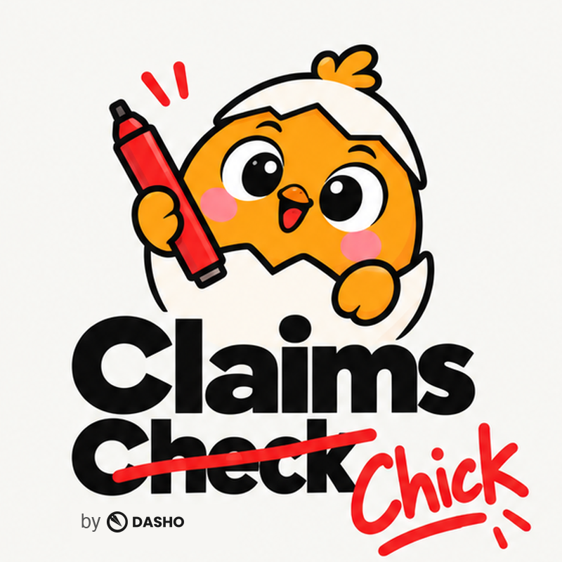

<p align="center"></p>

# Claims Check (by Dasho)

Meet **Sisiw the Judge** (SEE-seew; Tagalog for chick, and slang for "easy"). Sisiw watches the clip with you, reacts at every flagged second, and stamps PASSED on claims that hold up. A named person still makes the final call.

A brand team checks a creator's 15 to 90 second video, or an image or carousel post, **before it posts**. An agent built on Meta's Muse models:

- checks every factual product claim (spoken, written on screen, or in the post caption) against the brand's **source pack** (pasted product docs or URLs), and cites the exact source chunk;
- checks the paid partnership is **disclosed**: out loud in English, Tagalog or Taglish, on screen, or in the post caption (#ad, #sponsored, "may bayad");
- checks the brief's **key messages** are covered;
- with the optional **FDA beauty** pack, fails cure/treat claims and flags a missing "No approved therapeutic claims" line for food supplements;
- proposes a **corrected line in the creator's own voice** for each failed claim (Taglish stays Taglish), then re-checks it, up to two rounds.

A named human approves or requests changes. The agent never approves.

**Languages.** Tagalog/English (Taglish) supported; Cebuano/Bisaya is not in Muse Voice Transcribe's evaluated languages, so Bisaya clips are transcribed on a best-effort basis and every Bisaya claim is flagged for human review. The app detects the language (Cebuano-only function words, plus Muse Spark's own reading); when it is not Tagalog or English, each claim is marked `needs_human_review` and the note says "Language not verified".

**Inputs.** Video: MP4, MOV, M4V or WebM, vertical 9:16, square or landscape; the layout follows the clip's displayed shape (rotation metadata applied). A clip the browser may not play (for example iPhone HEVC .mov) gets an H.264 copy for playback while the agent works on the original. A clip with no audio skips transcription; a clip over 90 seconds is checked for its first 90 seconds. Images: one JPG or PNG, or up to 10 for a carousel; notes pin to image 1, 2, 3. Post caption: optional, checked for claims and disclosure.

**Who it is for:** brand and agency teams in the Philippines who pay creators to talk about their products. The lead pack is "Tech claims", for AI and software companies hiring Filipino business creators, where overclaims such as "guarantees zero errors" are common.

## Run it

```sh
python -m venv .venv && . .venv/bin/activate
pip install -r requirements.txt
uvicorn app:app --port 8000
```

Open http://127.0.0.1:8000.

| Mode | How to select | Needs |
|---|---|---|
| Offline fixture | no `MODEL_API_KEY` (or `CLAIMCHECK_PROVIDER=fixture`) | nothing; runs the whole flow on a fictional product, "Ledgerly AI", with a fixed planning policy and heuristic answers |
| Meta Model API | `MODEL_API_KEY=...` (or `CLAIMCHECK_PROVIDER=meta`) | `ffmpeg` and `ffprobe` on PATH |
| Muse Spark Open | `CLAIMCHECK_PROVIDER=open`, `OPEN_BASE_URL`, `OPEN_MODEL`, `OPEN_API_KEY` | any OpenAI-compatible server (local or Fireworks); speech goes to Muse Voice Transcribe when `MODEL_API_KEY` is set, otherwise to `OPEN_ASR_URL` (`/audio/transcriptions`) |

Optional settings: `MODEL_BASE_URL` (default `https://api.meta.ai/v1`), `MODEL_NAME` (default `muse-spark-1.3`), `ASR_MODEL` (default `muse-voice-transcribe-1.0`), `PLANNER_REASONING` (default `low`), `TASK_REASONING`, `FIXTURE_STEP_DELAY` (seconds between offline steps, default 0.35).

`/` is the review screen (timecode-pinned notes and an event log); `/classic` keeps the earlier chat-style screen. Both have **Replay recorded run**, which plays back the run named in `demo/replay.json` at three times its real pace without calling any API. `?auto=run` and `?auto=replay` start either one on load. To demo a new clip, record a live run with `demo/live_check.py --video <clip> --update-replay`.

The review screen includes an animated orange chick in an eggshell. Its bubbles follow the playhead (including pause and seek), and image posts react as each image is selected. Browser-generated sounds are available after the first click and can be muted.

Mascot art generated with ChatGPT image generation on 27 Oct 2026, during the hackathon.
Stamp frames generated with ChatGPT image generation on 27 Oct 2026.

### Hosting the demo

Set `DEMO_MODE=1` before hosting it for others:

| Setting | Default | Effect |
|---|---|---|
| `DEMO_DAILY_LIMIT` | 3 | live checks per IP address per UTC day; the replay is always free |
| `DEMO_ASK_LIMIT` | 10 | questions per IP address per day |
| `DEMO_MAX_MB` | 25 | upload size cap |
| `DEMO_MAX_SECONDS` | 60 | clip length cap |
| `DEMO_KEEP_SECONDS` | 600 | the original upload is deleted when the check ends; the playback copy this many seconds later |
| `DEMO_TRUST_PROXY` | off | set to 1 behind a proxy to read the client address from `X-Forwarded-For` |

The API key stays on the server; no endpoint returns it (tested).

Tests: `python -m pytest -q` (no network; all model calls are mocked).

Live check: `demo/make_test_video.sh` builds a 9 s clip with macOS `say` and a "Paid partnership with Dasho" caption, and `python demo/live_check.py --out demo/live-run-<date>.json` reviews it against the Meta API with a call budget.

## Architecture

```
upload ─► ffmpeg ─► 16 kHz WAV ─► Muse Voice Transcribe ─► timed turns ─► timed sentences
                └─► 3–6 JPEG frames (two in the first 3 s, where disclosures usually sit)

            ┌──────────────── agent loop (max 20 actions) ────────────────┐
 state ───► │ Muse Spark planner: sees state + every observation so far   │
            │   └─ native tool calls (parallel) on /responses             │
            │      fallback: JSON planner if the API rejects `tools`      │
            │ tools: extract_claims  search_source  fetch_source          │
            │        judge_claim  rewrite_line  check_disclosure          │
            │        check_coverage  finish                               │
            └──────────────────────────────┬───────────────────────────────┘
                                           ▼
                     guard (code): runs anything left open, labelled "completed by guard"
                                           ▼
                     review JSON ─► SSE trace + review cards ─► named human decision
```

| File | Role |
|---|---|
| `claimcheck/agent.py` | the loop, the 20-action cap, the guard, the trace (no event is ever dropped; a cap hit is its own event listing the calls it stopped) |
| `claimcheck/tools.py` | the eight tools and the code checks on every model answer |
| `claimcheck/providers.py` | Meta Model API and OpenAI-compatible (Muse Spark Open) providers, tool-calling fallback |
| `claimcheck/fixture.py` | offline provider and the fictional Ledgerly AI sample |
| `claimcheck/prompts.py` | every prompt in one place |
| `claimcheck/sources.py` | source pack parsing, BM25 retrieval over sentence chunks, safe URL fetching (public hosts only, pack URLs only) |
| `claimcheck/packs.py` | Tech claims and FDA beauty rule packs: rule chunks, hard rules, required disclaimers |
| `claimcheck/text.py` | sentence timing, quote location, word-offset time estimates |
| `claimcheck/web.py` | FastAPI: start a review, SSE event stream, replay, decision |
| `static/index.html` | the whole UI, plain HTML/CSS/JS |

### What code checks after the model answers

The model proposes; code verifies. Each rule below is covered by a test.

- A claim quote must exist in the transcript (or be text on a frame we actually sampled). Otherwise it is rejected and reported.
- A "supported" verdict must name a product source chunk and quote words that are in that chunk. Otherwise it is downgraded to "not supported".
- A rewrite is rejected before the judge sees it when it is empty, a pleasantry, much shorter than the original, a repeat, drops every topic word of the original, turns a Taglish line into English only, or still makes a therapeutic claim under the FDA pack.
- The judge must also say the rewrite keeps the creator's point. Round 2 receives round 1's line and its failure reason.
- Disclosure and coverage quotes must be in the transcript; on-screen findings must name a sampled frame time.
- FDA pack hard rules override the model: a cure/treat claim fails even when the model passes it.

### Timing

Muse Voice Transcribe returns turns with start and end times. A turn with one sentence keeps those times. Sentences inside a longer turn, and quotes inside a sentence, get times spread by word count; these are marked "time estimated" in the JSON and the UI.

## Meta models used

| Model | Used for | How |
|---|---|---|
| Muse Voice Transcribe (`muse-voice-transcribe-1.0`) | speech to timed text | `POST /v1/asr/transcribe`, multipart, `languageBias: ["Tagalog", "English"]`, product name as keyword |
| Muse Spark (`muse-spark-1.3`) as planner | choosing every next action | `POST /v1/responses` with a `tools` array; the model returns one or more `function_call` items plus a short commentary, shown in the trace |
| Muse Spark as verifier and writer | claim extraction, judging with citations, rewrites, coverage | `POST /v1/responses`, JSON answers checked by code |
| Muse Spark vision | on-screen disclosure, on-screen claim text, required disclaimers | the same call with 3 to 6 `input_image` frames |
| Muse Spark Open | the same agent on open weights | `OpenAICompatibleProvider`, `/chat/completions` with `tools` and `image_url` parts; implemented and unit-tested with a mocked server, not yet run against real weights |

## Live check, 27 Oct 2026 (Manila)

`demo/live-run-2026-10-27.json` is a real run against the Meta Model API on `demo/live-check.mp4` (spoken: "I tried Dasho for our brand posts. It guarantees zero FDA violations, one hundred percent. Every draft gets a named approver before it goes live."; on screen 1 to 3 s: "Paid partnership with Dasho"). Result: the overclaim failed; rewrite 1 was rejected by code for dropping the FDA topic; rewrite 2 passed citing S3; the approver claim passed citing S2; the disclosure was found on screen at 1.0 s; the key message was covered; the planner ran in native tool-calling mode for all 6 planning calls; 14 Muse Spark calls and 1 transcription call.

## Evaluation

Tested on 400 real Philippine paid ads.

## Built during the hackathon

- 27 Oct 2026: fresh repository; offline review prototype and tests.
- 27 Oct 2026: Meta Model API provider, ffmpeg media extraction, evaluation harness.
- 27 Oct 2026: agent loop in which Muse Spark plans every action with native tool calls, with a JSON planner fallback; 20-action cap logged as an event; deterministic guard for skipped work.
- 27 Oct 2026: code verification of every model answer (quotes, citations, frame times), rewrite rounds with failure reasons, topic and Taglish checks, FDA beauty pack with hard rules and the supplement disclaimer.
- 27 Oct 2026: word-offset timing inside long transcription turns, found during the live check.
- 27 Oct 2026: review UI with SSE trace, claim cards, rounds, decision and replay; Muse Spark Open provider.
- 27 Oct 2026: live check against the Meta Model API, saved in `demo/`.
- 27 Oct 2026: review screen with timecode ruler, note pins, frame strip, waveform, event log and tracked-change revisions; a real-browser test that no element has a border on one edge only.
- 27 Oct 2026: vertical, square and landscape layouts from the displayed clip size; H.264 playback copies for HEVC and WebM; no-audio and over-90-second clips.
- 27 Oct 2026: post caption (claims and disclosure), image and carousel posts, language check with human-review flags, and `DEMO_MODE` limits.
- 27 Oct 2026: original animated SVG review companion, playhead-synced reaction bubbles, gentle browser chimes, and reaction lines in the finish step.

A same-day prototype (26 Oct, before kickoff) existed in a separate private repo; no code from it is used here.

## License

AGPL-3.0; see [LICENSE](LICENSE).
